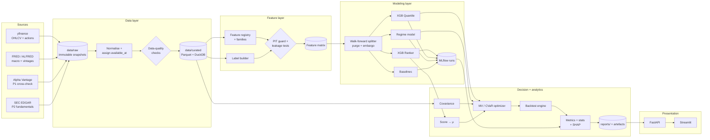

# QuantXGB — Product Requirements Document

**Point-in-Time, Regime-Aware Quantitative Research & Portfolio Intelligence**

| | |
|---|---|
| **Status** | Draft v0.1 — Stage 0 (research specification) |
| **Date** | 2026-11-22 |
| **Budget** | ₹0 additional spend (local-first, open-source, free data tiers) |
| **Primary builder** | Owner + Claude Code (bounded, reviewed tasks) |
| **Core tech** | Python · XGBoost (learning-to-rank + quantile regression) · Polars · DuckDB/Parquet · CVXPY · Optuna · SHAP · MLflow · FastAPI · Streamlit |

> **How to read this document.** Sections 1–4 define *what* and *why*. Sections 5–11 define *how* (requirements, architecture, data, models, portfolio, serving). Sections 12–14 fix the tech stack, repo layout and quality bar. Sections 15–18 cover delivery, risk, ownership and open decisions. Items marked **[DECISION]** are proposed defaults that the owner must confirm before Stage 1 starts.

---

## Table of contents

1. [Overview](#1-overview)
2. [Goals, non-goals and success criteria](#2-goals-non-goals-and-success-criteria)
3. [Users and key questions](#3-users-and-key-questions)
4. [Research specification](#4-research-specification)
5. [Functional requirements](#5-functional-requirements)
6. [System architecture](#6-system-architecture)
7. [Data architecture](#7-data-architecture)
8. [Feature specification](#8-feature-specification)
9. [Modeling and validation methodology](#9-modeling-and-validation-methodology)
10. [Portfolio construction and backtesting](#10-portfolio-construction-and-backtesting)
11. [API and dashboard](#11-api-and-dashboard)
12. [Technology stack](#12-technology-stack)
13. [Repository structure and configuration](#13-repository-structure-and-configuration)
14. [Non-functional requirements](#14-non-functional-requirements)
15. [Roadmap and milestones](#15-roadmap-and-milestones)
16. [Risks and mitigations](#16-risks-and-mitigations)
17. [Responsibility split and Claude Code working rules](#17-responsibility-split-and-claude-code-working-rules)
18. [Open questions and decision log](#18-open-questions-and-decision-log)

---

## 1. Overview

### 1.1 Product summary

QuantXGB is a local-first quantitative research platform that:

1. Ingests free market and macroeconomic data with **full provenance and availability timestamps**.
2. Engineers leakage-tested features across momentum, volatility, trend, liquidity, risk, cross-asset and macro families.
3. Trains **XGBoost learning-to-rank** models to rank assets by expected *relative* forward return, and **XGBoost quantile regression** models to forecast the forward return *distribution*.
4. Detects **market regimes** using only information available at each date.
5. Converts signals into portfolios with a **constrained mean-variance / CVaR optimizer** that includes turnover penalties and cost scenarios.
6. Evaluates everything with **purged, embargoed walk-forward validation**, an untouched final holdout, baselines, and statistical tests for backtest overfitting.
7. Exposes results through a **FastAPI** backend and a **Streamlit** research dashboard, with SHAP explanations.

### 1.2 Problem statement

Most ML-for-finance portfolio projects fail on methodology rather than code: they leak future information, overfit through repeated experimentation, ignore costs and execution delay, and report in-sample metrics as if they were achievable. QuantXGB exists to show that an XGBoost-centred research pipeline can be built **correctly**: auditable, reproducible, and honest about what the data does and does not support, including negative results.

### 1.3 Core philosophy

- **Correctness over performance.** A defensible negative result beats an attractive backtest nobody can trust.
- **Point-in-time by construction.** Every value carries the timestamp at which it could have been known; no feature may be computed from information after its decision time.
- **Bounded experimentation.** Every experiment is logged and counted, and the final holdout is used once.
- **Local-first and free.** Runs on a laptop CPU. No paid data, compute, hosting or APIs.
- **XGBoost is the centre of the work.** No deep learning or LLM features. The differentiator is the research and engineering around the model.

---

## 2. Goals, non-goals and success criteria

### 2.1 Goals

| ID | Goal |
|---|---|
| G1 | Build a reproducible, point-in-time data pipeline for a defined multi-asset ETF universe plus macro data. |
| G2 | Test whether XGBoost ranking adds out-of-sample predictive value over simple baselines, net of costs. |
| G3 | Produce calibrated probabilistic return forecasts (5th / 50th / 95th percentiles). |
| G4 | Characterise how signal quality varies across market regimes. |
| G5 | Build a constrained portfolio construction and backtesting engine with realistic timing and cost assumptions. |
| G6 | Deliver a dashboard + API that answers the eight key questions in §3.2. |
| G7 | Publish a research report and repository that a third party can clone, reproduce and critique. |

### 2.2 Non-goals (explicitly out of scope)

- Live or paper trading, broker integration, order management.
- Intraday or real-time data; anything faster than daily bars.
- Deep learning, LLM agents, sentiment/NLP features.
- A publicly hosted multi-user service.
- Redistribution of downloaded market data.
- Investment advice or performance claims beyond the documented research.
- Survivorship-bias-free single-stock backtests (deferred until point-in-time universe data exists; see P2 extension).

### 2.3 Success criteria: quality gates, not return targets

No Sharpe ratio or accuracy target is set in advance, because a target like that rewards overfitting. The project is successful when every gate below has evidence.

| Dimension | Gate (evidence required) |
|---|---|
| Data integrity | Every stored value has `source`, `observed_at`, `available_at`, `ingested_at`, `vintage`. Data-quality report generated per run. Limitations documented. |
| Leakage resistance | Truncation and future-perturbation tests pass for **100%** of features and labels. Noise-label sanity test shows no edge. |
| ML sophistication | Ranking (`rank:ndcg`, `rank:pairwise`) and quantile (`reg:quantileerror`) models trained with date-level groups. |
| Statistical rigour | Purged + embargoed walk-forward CV; untouched holdout; block-bootstrap CIs; Deflated Sharpe Ratio; PBO. |
| Experimentation | At least 4 baselines and a feature-family ablation study. All trials logged in MLflow with a trial counter. |
| Risk modelling | Pinball loss and empirical coverage reported; quantile forecasts used in portfolio construction. |
| Explainability | Global and local SHAP explanations; explicit "attribution ≠ causation" caveat. |
| Financial realism | Execution delay ≥ 1 bar; cost scenarios at 5 / 10 / 20 bps; turnover reported. |
| Engineering | `make all` reproduces the pipeline from raw data; ≥ 85% test coverage on `src/`; CI green. |
| Documentation | Methodology, experiments log, limitations and a final research report. |
| Usability | Dashboard runs locally with one command and answers all questions in §3.2. |

---

## 3. Users and key questions

### 3.1 Users

| Persona | Need |
|---|---|
| **Owner / researcher** (primary) | Run experiments, inspect data, interpret results, defend methodology in interviews. |
| **Reviewer** (quant researcher, ML engineer, hiring manager) | Clone the repo, reproduce results, audit leakage controls and assumptions quickly. |
| **Claude Code** (development agent) | Unambiguous specs, constraints and acceptance criteria per task. |

### 3.2 Key questions the finished platform must answer

1. Which assets have the most attractive predicted relative returns right now?
2. What is the predicted downside (5th percentile) and upside (95th percentile) for each asset?
3. Which market regime are we in, and how confident is that classification?
4. How much should we trust the predictions (historical IC, calibration, regime-conditional skill)?
5. Which features drove a given prediction?
6. How should the portfolio be allocated under the defined constraints?
7. How did the strategy perform out-of-sample after transaction costs, against baselines?
8. When does the model fail, and why?

---

## 4. Research specification

> This is the Stage 0 deliverable. All items marked **[DECISION]** must be frozen in `configs/` and committed **before** any model is trained. Changing them later requires a logged decision (§18).

### 4.1 Research hypothesis

> **H1:** Cross-asset momentum, volatility, trend and point-in-time macroeconomic features, modelled with XGBoost learning-to-rank, predict the cross-sectional ordering of 20-trading-day forward returns in a multi-asset ETF universe better than simple momentum and equal-weight baselines, and that edge survives realistic execution delay and transaction costs.
>
> **H2:** Quantile forecasts from XGBoost improve risk-adjusted portfolio outcomes (drawdown, CVaR) relative to covariance-only risk models.
>
> **H3:** Predictive skill differs significantly across market regimes.
>
> **Null outcome:** If H1 fails, the deliverable is a rigorous documentation of *why* (no edge, edge too small for costs, or regime-dependent edge).

### 4.2 Asset universe **[DECISION]**

A predefined, static research universe of 20 liquid US-listed ETFs. **Known limitation:** the universe is chosen with hindsight (all of these funds survived), so some survivorship bias remains. It is not representative of the full market.

| Ticker | Asset class | Exposure | Approx. inception* |
|---|---|---|---|
| SPY | Equity – US large cap | S&P 500 | 1993-01 |
| QQQ | Equity – US large cap growth | Nasdaq-100 | 1999-03 |
| IWM | Equity – US small cap | Russell 2000 | 2000-05 |
| EFA | Equity – Intl developed | MSCI EAFE | 2001-08 |
| EEM | Equity – Emerging | MSCI EM | 2003-04 |
| XLF | Equity – Sector | Financials | 1998-12 |
| XLK | Equity – Sector | Technology | 1998-12 |
| XLE | Equity – Sector | Energy | 1998-12 |
| XLV | Equity – Sector | Health care | 1998-12 |
| XLU | Equity – Sector | Utilities | 1998-12 |
| XLP | Equity – Sector | Consumer staples | 1998-12 |
| SHY | Rates – Short | 1–3Y Treasuries | 2002-07 |
| IEF | Rates – Intermediate | 7–10Y Treasuries | 2002-07 |
| TLT | Rates – Long | 20Y+ Treasuries | 2002-07 |
| TIP | Rates – Inflation-linked | US TIPS | 2003-12 |
| LQD | Credit – IG | Investment-grade corporates | 2002-07 |
| HYG | Credit – HY | High-yield corporates | 2007-04 |
| GLD | Commodity | Gold | 2004-11 |
| DBC | Commodity | Broad commodities | 2006-02 |
| VNQ | Real estate | US REITs | 2004-09 |

\* *Verify exact inception dates from the downloaded data in Stage 1 and record them in `configs/data.yaml`.*

- **Panel handling:** unbalanced panel. An asset becomes eligible on a date only once it has ≥ 252 trading days of history (feature warm-up).
- **Effective research start:** ~2008-04 (HYG inception + warm-up). Earlier data is used only for warm-up.
- **Asset-class tags** are stored per ticker for neutralisation and concentration constraints.

### 4.3 Timing conventions **[DECISION]**

| Item | Default |
|---|---|
| Bar frequency | Daily |
| Decision time `t` | After the close of trading day `t` (features may use the close of `t`) |
| Signal frequency | Weekly (last trading day of each week) |
| Execution | At the **close of `t+1`** (one full bar delay; conservative vs. next open) |
| Primary horizon `h` | 20 trading days |
| Secondary horizon | 5 trading days (comparison experiment) |
| Rebalance frequency | Every 4 weeks (default); weekly as a sensitivity test |
| Calendar | NYSE trading calendar (`exchange_calendars` / `pandas_market_calendars`) |

### 4.4 Prediction targets

Let `TR_i(t)` be the total-return index of asset *i* (dividends reinvested, split-adjusted, computed in-house from raw prices and dividends; see §7.4).

- **Forward return (aligned with execution):**
  `R_i(t, h) = TR_i(t+1+h) / TR_i(t+1) − 1`
- **Ranking target (Model A):** cross-sectional excess return `R_i − mean_j R_j` on date `t`, converted to **integer relevance grades 0–4** by within-date quintile (required for `rank:ndcg`). The continuous excess return is kept for IC evaluation.
- **Distribution target (Model B):** raw `R_i(t, h)` (absolute, not relative), so quantiles feed the risk model directly.

### 4.5 Benchmarks and baselines

| Baseline | Definition |
|---|---|
| B1 Equal weight | 1/N across eligible assets, rebalanced on the same schedule |
| B2 60/40 | 60% SPY / 40% IEF |
| B3 SPY buy-and-hold | Market reference |
| B4 Cross-sectional momentum | Rank on 12-1 month momentum; hold the top-k, equal weight |
| B5 Inverse volatility | Weights ∝ 1/σ₆₀ |
| B6 Linear ranker | Ridge regression on the same features → rank |
| B7 Random Forest | Same features and target as XGBoost |

The XGBoost strategy must be compared with B1–B7 using **identical** timing, constraints and cost assumptions.

### 4.6 Data splits **[DECISION]**

| Segment | Period | Use |
|---|---|---|
| Warm-up | data start → 2008-03 | Feature history only |
| Development | 2008-04 → 2024-09 | Walk-forward CV, model selection, tuning |
| Gap | 2024-10 | Purge/embargo buffer (≥ h + embargo) |
| **Final holdout** | **2024-11-01 → 2026-10-30** | **Touched once**, after methodology freeze |

The holdout boundaries are written to `configs/backtest.yaml` and enforced in code: any data loader called from a model-selection context raises an error if it touches holdout dates.

### 4.7 Transaction cost assumptions

Fixed one-way costs of **5, 10 and 20 bps** of traded notional, applied to turnover. These are **stress-test assumptions**, not measured spreads or market-impact estimates. Daily OHLCV cannot support a realistic execution model, and the report must say so.

---

## 5. Functional requirements

Priority: **P0** = MVP (required for the research claim), **P1** = full scope, **P2** = extension.

### 5.1 Data ingestion and storage (FR-DATA)

| ID | Requirement | Pri |
|---|---|---|
| FR-DATA-01 | Download daily OHLCV, dividends and splits for the configured universe via a provider abstraction (default: yfinance). | P0 |
| FR-DATA-02 | Store prices and corporate actions **as served by the provider** (Yahoo: split-adjusted, not distribution-adjusted; see §7.4) as immutable snapshots with download timestamp and content hash. | P0 |
| FR-DATA-03 | Compute in-house adjusted prices and total-return index from raw prices + actions; reconcile against provider-adjusted series and flag differences. | P0 |
| FR-DATA-04 | Download FRED series and **ALFRED vintages** for revised series, storing `realtime_start` / `realtime_end`. | P0 |
| FR-DATA-05 | Assign `available_at` to every record per the rules in §7.3. | P0 |
| FR-DATA-06 | Rate limiting, retries with exponential backoff, and resumable incremental updates for all providers. | P0 |
| FR-DATA-07 | Persist to partitioned Parquet; expose curated views via DuckDB. | P0 |
| FR-DATA-08 | Data-quality checks: missing days vs. calendar, duplicates, non-positive prices, outlier returns, stale prices, split/dividend anomalies, vintage gaps. Generate an HTML/Markdown report per run. | P0 |
| FR-DATA-09 | Alternative price provider (Alpha Vantage) behind the same interface for cross-validation of prices. | P1 |
| FR-DATA-10 | SEC EDGAR XBRL ingestion (companyfacts / submissions) with filing `acceptanceDateTime` as `available_at`; declared User-Agent; ≤ 10 req/s. | P2 |

### 5.2 Point-in-time validation (FR-PIT)

| ID | Requirement | Pri |
|---|---|---|
| FR-PIT-01 | As-of join utility: for decision time `t`, return only records with `available_at ≤ t`, latest vintage first. | P0 |
| FR-PIT-02 | Guard that rejects any feature whose `available_at` > decision timestamp. | P0 |
| FR-PIT-03 | **Truncation test:** features computed on data truncated at `t` equal features computed on full data, for sampled `t`. | P0 |
| FR-PIT-04 | **Future-perturbation test:** randomly perturbing all data after `t` leaves features at ≤ `t` unchanged. | P0 |
| FR-PIT-05 | Label-alignment test: label for `t` uses only prices from `t+1` to `t+1+h`. | P0 |
| FR-PIT-06 | Holdout guard: model-selection code paths cannot read holdout dates. | P0 |

### 5.3 Features (FR-FEAT)

| ID | Requirement | Pri |
|---|---|---|
| FR-FEAT-01 | Implement feature families from §8 as pure functions driven by `configs/features.yaml`. | P0 |
| FR-FEAT-02 | Feature registry: each feature declares name, family, formula, lookback, economic rationale, and availability rule. | P0 |
| FR-FEAT-03 | Cross-sectional transforms (rank, z-score) computed within date only. | P0 |
| FR-FEAT-04 | Feature matrix materialised to Parquet with schema validation (Pandera). | P0 |
| FR-FEAT-05 | Auto-generated feature documentation (`research/feature_dictionary.md`) from the registry. | P1 |

### 5.4 Models (FR-MODEL)

| ID | Requirement | Pri |
|---|---|---|
| FR-MODEL-01 | Baselines B1–B7 (§4.5). | P0 |
| FR-MODEL-02 | XGBoost ranker with `rank:ndcg` and date-level query groups. | P0 |
| FR-MODEL-03 | `rank:pairwise` comparison experiment. | P1 |
| FR-MODEL-04 | XGBoost quantile model (`reg:quantileerror`, α ∈ {0.05, 0.5, 0.95}) with post-hoc non-crossing enforcement. | P0 |
| FR-MODEL-05 | Rule-based regime classifier (volatility, trend, rates, correlation). | P0 |
| FR-MODEL-06 | Gaussian HMM regime model, refit per training window, using **filtered** (not smoothed) state probabilities. | P1 |
| FR-MODEL-07 | Optuna tuning with a fixed trial budget, nested inside walk-forward folds. | P1 |
| FR-MODEL-08 | Asset-class neutralisation of the ranking target as an experiment. | P1 |

### 5.5 Validation and experiments (FR-VAL)

| ID | Requirement | Pri |
|---|---|---|
| FR-VAL-01 | Expanding-window walk-forward splitter with purging (≥ h days) and embargo. | P0 |
| FR-VAL-02 | Metrics from §9.5 per fold, per regime, and aggregated. | P0 |
| FR-VAL-03 | MLflow logging of params, metrics, artefacts, data hash, git SHA and a global trial counter. | P0 |
| FR-VAL-04 | Feature-family ablation (drop one family at a time). | P1 |
| FR-VAL-05 | Stationary block-bootstrap confidence intervals for IC and Sharpe. | P0 |
| FR-VAL-06 | Deflated Sharpe Ratio using the logged trial count; PBO via CSCV. | P1 |
| FR-VAL-07 | Noise-label sanity test: training on shuffled labels must show ≈ 0 IC. | P0 |
| FR-VAL-08 | One-shot holdout evaluation script that refuses to run twice without an explicit override logged in §18. | P0 |

### 5.6 Portfolio and backtest (FR-PORT / FR-BT)

| ID | Requirement | Pri |
|---|---|---|
| FR-PORT-01 | Covariance estimation: sample, Ledoit-Wolf shrinkage, EWMA. | P0 |
| FR-PORT-02 | Mapping from ranking scores to expected returns (§10.2). | P0 |
| FR-PORT-03 | Mean-variance optimizer with turnover penalty and constraints (§10.3) via CVXPY. | P0 |
| FR-PORT-04 | CVaR optimizer (Rockafellar–Uryasev LP) using historical and quantile-derived scenarios. | P1 |
| FR-PORT-05 | Regime-conditional risk aversion (e.g., λ higher in high-vol regime) as an experiment. | P2 |
| FR-BT-01 | Event-driven daily backtest: signal at `t`, trade at close `t+1`, holdings drift between rebalances. | P0 |
| FR-BT-02 | Turnover-based costs at configurable bps; cost scenarios run in one command. | P0 |
| FR-BT-03 | Accounting-identity checks every bar (NAV change = Σ wᵢ·rᵢ − costs). | P0 |
| FR-BT-04 | Performance metrics and benchmark-relative statistics (§9.5). | P0 |

### 5.7 Explainability (FR-XAI)

| ID | Requirement | Pri |
|---|---|---|
| FR-XAI-01 | SHAP TreeExplainer global importance per model and per fold. | P1 |
| FR-XAI-02 | Local explanation for any (asset, date) prediction. | P1 |
| FR-XAI-03 | SHAP interaction values for top features; regime-conditional importance. | P2 |

### 5.8 Serving (FR-API / FR-UI)

| ID | Requirement | Pri |
|---|---|---|
| FR-API-01 | Read-only FastAPI service over precomputed artefacts (§11.1). | P1 |
| FR-UI-01 | Streamlit dashboard with pages in §11.2. | P1 |
| FR-OPS-01 | Docker + docker-compose for API + dashboard + MLflow UI. | P1 |

---

## 6. System architecture

### 6.1 Layered view

```
┌──────────────────────────────────────────────────────────────────────────┐
│  PRESENTATION      Streamlit dashboard  ·  FastAPI (read-only)  ·  MLflow UI │
├──────────────────────────────────────────────────────────────────────────┤
│  ANALYTICS         Backtest engine · Metrics · Statistical tests · SHAP     │
├──────────────────────────────────────────────────────────────────────────┤
│  DECISION          Score→μ mapping · Covariance · MV / CVaR optimizer       │
├──────────────────────────────────────────────────────────────────────────┤
│  MODELING          Baselines · XGB Ranker · XGB Quantile · Regime (rules/HMM)│
│                    Walk-forward splitter (purge + embargo) · Optuna         │
├──────────────────────────────────────────────────────────────────────────┤
│  FEATURES          Feature registry · Families · Cross-sectional transforms │
│                    Label builder · PIT guard                                │
├──────────────────────────────────────────────────────────────────────────┤
│  DATA              Providers (yfinance, FRED/ALFRED, AV, EDGAR)             │
│                    Raw snapshots → Normalise → Curated (Parquet + DuckDB)   │
│                    Data-quality checks · Provenance                         │
├──────────────────────────────────────────────────────────────────────────┤
│  PLATFORM          configs/*.yaml (Pydantic) · Typer CLI · Makefile ·       │
│                    pytest + Hypothesis · ruff · uv · Docker · GitHub Actions│
└──────────────────────────────────────────────────────────────────────────┘
```

**Dependency rule:** each layer depends only on layers below it. `api/` and `app/` never import training code; they read artefacts.

### 6.2 Data and control flow



### 6.3 Component responsibilities

| Component | Module | Inputs → Outputs |
|---|---|---|
| Provider adapters | `src/quantxgb/ingestion/` | API calls → raw snapshot files + manifest |
| Normaliser | `src/quantxgb/ingestion/normalize.py` | raw → curated long-format tables with PIT columns |
| Data quality | `src/quantxgb/validation/data_quality.py` | curated tables → DQ report, pass/fail |
| PIT utilities | `src/quantxgb/validation/point_in_time.py` | as-of joins, availability guards |
| Feature engine | `src/quantxgb/features/` | curated + config → feature matrix |
| Label builder | `src/quantxgb/labels/` | TR index → forward returns, relevance grades |
| Splitter | `src/quantxgb/validation/splits.py` | dates + horizon → purged/embargoed folds |
| Models | `src/quantxgb/models/` | feature matrix + folds → predictions, fitted models |
| Portfolio | `src/quantxgb/portfolio/` | predictions + returns → target weights |
| Backtest | `src/quantxgb/backtest/` | weights + prices → NAV, trades, costs, metrics |
| Explainability | `src/quantxgb/explainability/` | model + features → SHAP artefacts |
| Pipeline/CLI | `src/quantxgb/cli.py` | `quantxgb data|features|train|backtest|report|holdout` |
| API | `src/quantxgb/api/` | artefacts → JSON |
| Dashboard | `app/` | API / artefacts → UI |

### 6.4 Pipeline execution

Each stage is an idempotent CLI command that writes versioned artefacts keyed by `(config_hash, data_hash)`, so a stage is skipped when its inputs haven't changed.

```
make data       → quantxgb data ingest && quantxgb data validate
make features   → quantxgb features build
make train      → quantxgb train --experiment <name>
make backtest   → quantxgb backtest --run <run_id> --costs 5,10,20
make report     → quantxgb report --run <run_id>
make holdout    → quantxgb holdout --run <run_id>   # one-shot, guarded
make app        → docker compose up (API + dashboard + MLflow UI)
make test       → pytest -q
make all        → data features train backtest report
```

---

## 7. Data architecture

### 7.1 Sources

| Data | Source | Access | Limits / terms | Priority |
|---|---|---|---|---|
| Daily OHLCV, dividends, splits | yfinance (Yahoo Finance) | No key | Unofficial; personal research use; **no redistribution** | P0 |
| Macro (rates, inflation, labour, credit, conditions) | FRED API | Free key | Attribution required; check per-series copyright (some third-party series are restricted) | P0 |
| Macro vintages | ALFRED (same API, `realtime_start/end`) | Free key | As above | P0 |
| VIX | FRED `VIXCLS` (preferred) or yfinance `^VIX` | — | As above | P0 |
| Alternative prices | Alpha Vantage | Free key | ~25 req/day free tier; check open-source/education eligibility | P1 |
| Fundamentals | SEC EDGAR XBRL APIs | No key, User-Agent required | ≤ 10 req/s fair access | P2 |

### 7.2 Initial macro series **[DECISION]**

| Series ID | Description | Freq | Revised? | Availability rule |
|---|---|---|---|---|
| DGS10, DGS2, DGS3MO | Treasury yields | Daily | No | obs_date + 1 business day |
| T10Y2Y, T10Y3M | Curve slopes | Daily | No | obs_date + 1 business day |
| BAA10Y | Moody's Baa − 10Y spread | Daily | No | obs_date + 1 business day |
| VIXCLS | VIX close | Daily | No | obs_date (close) + 1 business day (conservative) |
| FEDFUNDS / DFF | Fed funds rate | Daily/Monthly | Rarely | obs_date + 1 business day |
| CPIAUCSL | CPI | Monthly | **Yes** | ALFRED first-vintage `realtime_start` |
| UNRATE | Unemployment rate | Monthly | **Yes** | ALFRED `realtime_start` |
| INDPRO | Industrial production | Monthly | **Yes** | ALFRED `realtime_start` |
| NFCI | Chicago Fed financial conditions | Weekly | **Yes** | ALFRED `realtime_start` |

> Avoid ICE BofA OAS series on FRED unless their current history length and terms are verified; `BAA10Y` is the default credit-spread proxy.

### 7.3 Point-in-time (bitemporal) data model

All curated time series use a long, bitemporal schema:

| Column | Type | Meaning |
|---|---|---|
| `entity_id` | str | Ticker or FRED series ID |
| `field` | str | e.g. `close_raw`, `volume`, `dividend`, `value` |
| `observed_at` | date | Period the value describes (trading day, month, quarter) |
| `published_at` | timestamp | When the source first released it (if known) |
| `available_at` | timestamp | **Earliest time the model may use it** (≥ published_at, conservative) |
| `vintage` | date | ALFRED `realtime_start` / snapshot date |
| `value` | float | Value |
| `source` | str | Provider name + endpoint |
| `ingested_at` | timestamp | When we downloaded it |
| `snapshot_hash` | str | Hash of the raw file it came from |

**Availability rules**

| Data type | `available_at` |
|---|---|
| Daily price bar for day `d` | Close of `d` (16:00 ET) |
| Dividend / split | Ex-date open (affects close of ex-date) |
| Daily FRED market series for `d` | Close of `d+1` business day |
| Revised macro (ALFRED) | `realtime_start` of the vintage, end of day |
| SEC filing (P2) | `acceptanceDateTime` → next trading day close |

**As-of join** (DuckDB):

```sql
SELECT d.decision_ts, m.entity_id, m.value
FROM decision_dates d
ASOF JOIN macro_pit m
  ON m.entity_id = ?
 AND m.available_at <= d.decision_ts;
```

For revised series, the join selects the **latest vintage whose `realtime_start ≤ decision_ts`** and, within it, the latest `observed_at`. This reproduces exactly what an investor could have seen.

### 7.4 Corporate actions and total return

- Store close, splits, dividends and capital gains separately, exactly as served (`auto_adjust=False`). Do not rely on the provider's adjusted close as the source of truth.
- **Verified in implementation:** Yahoo's `Close` (and OHLC, volume, distributions) is already **split-adjusted** but not distribution-adjusted; a truly unadjusted close is not available. Applying split ratios again would double-count splits.
- Build the total-return index in-house: `TR_t = TR_{t-1} × (Close_t + Div_t + CapGain_t) / Close_{prev valid}` on the split-adjusted close.
- Reconcile against Yahoo's adjusted close. Flag daily return deviations > 0.5% for manual review (on the 2000–2026 data, cumulative TR matches within ~0.1% for all 20 ETFs).
- **Caveat:** Yahoo can silently revise history. Raw snapshots are immutable and dated, so any revision shows up as a diff between snapshots.

### 7.5 Storage layout

```
data/
├── raw/                         # immutable, never edited, git-ignored
│   ├── yfinance/2026-11-22/SPY.parquet
│   ├── fred/2026-11-22/CPIAUCSL_vintages.parquet
│   └── manifest.jsonl           # file, source, params, ingested_at, sha256
├── curated/                     # normalised PIT tables (Parquet, partitioned)
│   ├── prices/entity_id=SPY/
│   ├── corporate_actions/
│   └── macro_pit/
├── features/                    # feature matrices keyed by config hash
├── labels/
└── quantxgb.duckdb              # views over curated/ + features/
```

### 7.6 Data-quality checks

| Check | Rule | Action |
|---|---|---|
| Calendar completeness | Missing trading days vs. NYSE calendar | Warn > 0; fail > 0.5% |
| Duplicates | Unique (entity_id, field, observed_at, vintage) | Fail |
| Non-positive prices | close ≤ 0 | Fail |
| Outlier returns | \|r\| > 8σ₂₅₂ or > 25% daily for ETFs | Flag for manual review |
| Stale prices | ≥ 3 identical consecutive closes with volume > 0 | Flag |
| OHLC consistency | low ≤ open, close ≤ high | Fail |
| Adjustment reconciliation | In-house vs provider adjusted > 0.5% | Flag |
| Vintage integrity | Revised series must have ≥ 1 vintage per observation | Fail |
| Availability sanity | available_at ≥ observed_at | Fail |

---

## 8. Feature specification

### 8.1 Principles

- Every feature has a written **economic rationale**, an exact **formula**, a **lookback**, and an **availability rule**. Features without a rationale are not added.
- Target ~60–100 features. Do not pad the count.
- All rolling windows use data up to and including `t` only (`closed='right'`, no centring).
- Cross-sectional transforms (rank, z-score) are computed **within date**.
- **Market-wide features** (macro, regime) are constant within a ranking group. In a ranking model they can only matter through **interactions** with asset-level features. This is intended (e.g., "momentum works differently when VIX is high"), and it should be checked in the ablation study.

### 8.2 Feature families

Notation: `P` = adjusted close, `r` = daily log return, `σ_k` = annualised std of `r` over k days, `k` ∈ configured lookbacks.

| Family | Features | Formula (asset *i*, date *t*) | Rationale |
|---|---|---|---|
| **Momentum** | `ret_k`, k ∈ {5, 10, 20, 60, 120, 252} | `P_t / P_{t−k} − 1` | Time-series & cross-sectional momentum |
| | `mom_12_1` | `P_{t−21} / P_{t−252} − 1` | Classic momentum skipping short-term reversal |
| | `ret_k_voladj` | `ret_k / σ_k` | Risk-adjusted momentum |
| | `ret_k_xsrank` | within-date percentile rank of `ret_k` | Relative strength |
| **Volatility** | `vol_k`, k ∈ {20, 60, 120} | `std(r_{t−k+1..t}) × √252` | Risk level; low-vol anomaly |
| | `downvol_60` | std of negative `r` × √252 | Downside risk |
| | `vol_ratio` | `vol_20 / vol_120` | Volatility regime shift |
| | `parkinson_20` | `√(mean(ln(H/L)²) / (4 ln 2)) × √252` | Range-based vol estimate |
| **Trend** | `px_ema_k`, k ∈ {20, 50, 200} | `P_t / EMA_k(P)_t − 1` | Trend distance |
| | `ema_20_50` | `EMA_20 / EMA_50 − 1` | Crossover state |
| | `slope_60` | OLS slope of `ln P` on time over 60d / σ | Trend strength |
| | `up_frac_20` | share of positive `r` in 20d | Trend consistency |
| **Liquidity** | `log_dvol_20` | `ln(mean(P × Volume, 20d))` | Tradability |
| | `vol_z_20` | z-score of volume vs. 60d | Attention / flows |
| | `amihud_20` | `mean(|r| / (P × Volume))` × 1e9 | Price impact proxy |
| **Risk** | `beta_spy_k`, k ∈ {60, 252} | `cov(r_i, r_SPY) / var(r_SPY)` | Market exposure |
| | `dd_252` | `P_t / max(P_{t−251..t}) − 1` | Drawdown state |
| | `mdd_120` | max drawdown in 120d window | Tail behaviour |
| | `skew_60`, `kurt_60` | sample moments of `r` | Distribution shape |
| **Cross-asset** | `rel_spy_k` | `ret_k(i) − ret_k(SPY)` | Relative to equity market |
| | `rel_class_k` | `ret_k(i) − mean ret_k(asset class)` | Within-class strength |
| | `corr_spy_60`, `corr_tlt_60` | rolling correlation | Diversification role |
| **Macro** (market-wide) | `y10`, `dy10_20` | 10Y level, 20d change | Rate environment |
| | `slope_10_2`, `slope_10_3m` | curve slopes | Cycle / recession signal |
| | `credit_spread`, `dcredit_20` | BAA10Y level, change | Risk appetite |
| | `cpi_yoy` | YoY from **vintage** CPI | Inflation regime |
| | `unrate_chg_3m` | 3-month change, vintage | Labour cycle |
| | `nfci` | latest vintage | Financial conditions |
| | `vix`, `vix_pct_252` | level, 1y percentile | Fear / vol regime |
| **Regime** (market-wide) | `spy_above_200` | `P_SPY > SMA_200` | Trend regime |
| | `avg_corr_60` | mean pairwise correlation of universe | Diversification breakdown |
| | `hmm_p_state_k` | filtered HMM state probabilities | Latent regime |

### 8.3 Labels

| Label | Definition | Used by |
|---|---|---|
| `fwd_ret_h` | `TR(t+1+h)/TR(t+1) − 1` | Quantile model; evaluation |
| `fwd_xs_ret_h` | `fwd_ret_h − mean_j fwd_ret_h` | IC evaluation |
| `fwd_grade_h` | within-date quintile of `fwd_xs_ret_h`, 0–4 | `rank:ndcg` / `rank:pairwise` |

Rows whose label window extends past the last available date are dropped, never filled.

---

## 9. Modeling and validation methodology

### 9.1 Model A: XGBoost learning-to-rank

- **Objective:** `rank:ndcg` (primary), `rank:pairwise` (comparison).
- **Groups:** one query group per decision date, containing all eligible assets on that date. Rows sorted by date, with `group` / `qid` set accordingly.
- **Eval metric:** `ndcg@5` (top quartile of a 20-asset universe), with rank IC also logged.
- **Output:** a score per (asset, date). Scores are **ordinal**; they are not returns.
- **Regularisation focus:** low depth (2–5), strong `min_child_weight`, `subsample`/`colsample` < 1, early stopping on an inner validation slice taken from the training fold's **tail** (purged).

### 9.2 Model B: XGBoost quantile regression

- **Objective:** `reg:quantileerror` with `quantile_alpha = [0.05, 0.5, 0.95]` (multi-quantile, single model).
- **Target:** `fwd_ret_h` (absolute).
- **Post-processing:** sort the three outputs per row to remove quantile crossing; log the crossing rate before the fix.
- **Evaluation:** pinball loss per quantile; empirical coverage of [Q05, Q95] (target 90%); coverage by regime; comparison vs. historical-quantile and Gaussian-σ baselines.

### 9.3 Regime models

| Model | Inputs | Output | Leakage control |
|---|---|---|---|
| Rule-based (P0) | VIX percentile, SPY vs 200d SMA, 10Y–2Y slope, avg correlation | Discrete labels, e.g. `risk_on / neutral / risk_off`, `high_vol / low_vol` | Thresholds set from **training window** percentiles only |
| Gaussian HMM (P1) | SPY daily return, 20d vol, credit-spread change | State probabilities (2–3 states) | Refit per fold on training data; inference uses the **forward (filtered)** algorithm only, never Viterbi/smoothed paths over the full sample |

Regimes are used to (a) slice evaluation metrics, (b) feed features, and (c) optionally condition portfolio risk aversion (P2). States must be interpreted and named by the owner after inspecting their statistics.

### 9.4 Walk-forward validation

```
Development period 2008-04 ─────────────────────────────────────────── 2024-09

Fold 1  [====== train (≥5y) ======]▒▒[ test 6m ]
Fold 2  [========= train ==========]▒▒[ test 6m ]
Fold 3  [============ train ============]▒▒[ test 6m ]
 ...                                              (expanding window)
Fold N  [======================= train =======================]▒▒[ test 6m ]

▒▒ = purge (h = 20 trading days) + embargo (5 trading days)
```

- **Expanding** training window; minimum 5 years; 6-month test blocks; ~22 folds.
- **Purging:** drop training rows whose label window `[t+1, t+1+h]` overlaps the test period.
- **Embargo:** an additional 5 trading days after each test block are excluded from subsequent training (relevant with overlapping labels and serial correlation).
- **Hyperparameter tuning (nested):** Optuna runs **inside** each fold's training data using an inner purged split, with a **fixed budget** (default 40 trials, TPE sampler, fixed seed). Total trials are counted for the Deflated Sharpe calculation.
- **Holdout:** after methodology freeze, retrain on the full development period and evaluate once on 2024-11 → 2026-10.

### 9.5 Metrics

**Signal quality**

| Metric | Definition |
|---|---|
| Rank IC | Spearman ρ(score, fwd_xs_ret) per date; reported as mean, median, % positive |
| ICIR | mean(IC) / std(IC); t-stat with Newey–West SE (overlapping labels) |
| NDCG@k | Per-date NDCG at k = 5 |
| Top-k hit rate | Share of top-k picks with positive excess return |
| Quantile spread | Mean fwd return of top quintile − bottom quintile |

**Distribution forecasts:** pinball loss, coverage, interval width, crossing rate.

**Portfolio**

| Metric | Notes |
|---|---|
| CAGR, annualised vol | Net of costs |
| Sharpe, Sortino | Risk-free rate from DGS3MO (PIT) |
| Max drawdown, Calmar | |
| Historical VaR/CVaR 95% | Daily and 20d |
| Turnover, cost drag | Annualised one-way turnover; bps lost to costs |
| Tracking error, information ratio | vs. B1 and B3 |
| Block-bootstrap 95% CI | Stationary bootstrap, mean block ≈ 20 days, 2,000 resamples |
| Deflated Sharpe Ratio | Uses total logged trials and return skew/kurtosis |
| PBO | CSCV over the set of tried configurations |

### 9.6 Experiment protocol

1. **Pre-register.** Before running, write the hypothesis, config and expected outcome into `research/experiments.md`.
2. **Run** via CLI; MLflow logs params, metrics, `git_sha`, `data_hash`, `config_hash`, `trial_index`.
3. **Record** results, including failures, in `research/experiments.md`.
4. **No silent re-runs.** Every configuration tried counts toward the DSR/PBO trial count.
5. **Freeze** methodology (tag `v-methodology-freeze`) before running the holdout.

---

## 10. Portfolio construction and backtesting

### 10.1 Pipeline per rebalance date `t`

```
scores(t) ─► μ(t)  ─┐
quantiles(t) ───────┼─► optimizer ─► w*(t) ─► trade at close t+1 ─► drift until next rebalance
Σ(t) ───────────────┤
regime(t) ──────────┤ (optional λ adjustment)
w(t⁻) ──────────────┘ (for turnover)
```

### 10.2 From ranking scores to expected returns

Ranking scores are ordinal, so they are mapped to expected returns using the Grinold rule:

`μ_i(t) = IC̄ × σ_i(t) × z_i(t)`

where `z_i` is the within-date z-score of the model score, `σ_i` is forecast volatility (20d horizon), and `IC̄` is the mean rank IC estimated **on the training fold only**. A score that carries no information therefore produces a near-zero μ.

### 10.3 Optimisation problems

**Mean-variance with turnover (P0)**

```
maximise    μᵀw − λ·wᵀΣw − γ·‖w − w_prev‖₁
subject to  1ᵀw = 1,  0 ≤ w_i ≤ w_max                  (long-only, fully invested)
            Σ_{i∈class c} w_i ≤ c_max                  (asset-class concentration)
            ‖w − w_prev‖₁ ≤ τ_max                      (turnover cap)
```

**CVaR (P1)**: Rockafellar–Uryasev linear program over S scenarios:

```
maximise    μᵀw − κ·( ζ + 1/((1−β)S) Σ_s u_s ) − γ·‖w − w_prev‖₁
subject to  u_s ≥ −r_sᵀw − ζ,  u_s ≥ 0,  plus constraints above
```

Scenarios: (a) historical 20d returns from the training window, (b) scenarios drawn from the quantile model's per-asset distributions combined with the empirical correlation structure (Gaussian copula). Both variants are reported.

**Default constraint values [DECISION]:** `w_max = 0.25`, `c_max = 0.50` per asset class, `τ_max = 0.50` per rebalance, `λ` and `γ` chosen in walk-forward from a small grid (counted as trials).

**Covariance:** Ledoit–Wolf shrinkage on 252d daily returns (default); EWMA (half-life 60d) and sample covariance as alternatives; scaled to the 20d horizon.

**Solver:** CVXPY with the bundled open-source solvers (Clarabel / OSQP / ECOS / SCS). If the solver fails, the fallback is to hold the previous weights, and the event is logged.

### 10.4 Backtest engine

- **Daily event loop** over trading days. On a rebalance signal at `t`, target weights are executed at the close of `t+1`. Between rebalances, holdings drift with returns (no implicit daily rebalancing).
- **Costs:** `cost_t = c_bps × Σ|w_target − w_drifted|` × NAV, deducted at execution.
- **Cash:** zero-return cash by default; optional cash at the DGS3MO rate.
- **Accounting identity** asserted every bar: `NAV_t = NAV_{t−1} × (1 + Σ w_{i,t−1} r_{i,t}) − cost_t`.
- **Outputs:** NAV series, weights, trades, costs, turnover, per-asset contribution, regime tags.
- **Determinism:** same inputs and seed always produce identical outputs (tested).

---

## 11. API and dashboard

### 11.1 FastAPI endpoints (read-only, P1)

| Method | Path | Returns |
|---|---|---|
| GET | `/health` | Service + artefact version |
| GET | `/universe` | Tickers, asset classes, inception, eligibility by date |
| GET | `/rankings?date=&run_id=` | Scores, ranks, μ per asset |
| GET | `/risk?date=&run_id=` | Q05 / Q50 / Q95 per asset, interval width |
| GET | `/regime?date=` | Rule-based labels + HMM probabilities |
| GET | `/portfolio?date=&run_id=&cost_bps=` | Target weights, turnover, constraint status |
| GET | `/explain/{ticker}?date=&run_id=` | Top-N SHAP contributions |
| GET | `/backtests/{run_id}` | NAV, metrics, benchmark comparison |
| GET | `/experiments` | MLflow run summaries |
| GET | `/data-health` | Latest data-quality report |

Responses are typed with Pydantic models; an OpenAPI schema is auto-generated. The API never trains models or downloads data.

### 11.2 Streamlit dashboard pages

| Page | Content | Answers Q# |
|---|---|---|
| Overview | Latest date, regime badge, top-5 ranked assets, portfolio snapshot, data freshness | 1, 3, 6 |
| Rankings | Ranked table, score history, rank IC over time | 1, 4 |
| Risk | Fan charts of Q05/Q50/Q95, coverage history, calibration plot | 2, 4 |
| Regime | Regime timeline over SPY, HMM probabilities, regime-conditional IC | 3, 8 |
| Portfolio | Weights, constraint utilisation, turnover, cost scenario toggle | 6 |
| Backtest | NAV vs baselines, drawdowns, rolling Sharpe, bootstrap CIs, DSR/PBO | 7 |
| Explainability | Global SHAP, local waterfall per (asset, date), interactions | 5 |
| Experiments | Run comparison, ablation table, trial counter | 4, 8 |
| Data health | DQ report, provenance, vintage coverage, known limitations | — |

Every performance page has a persistent footer stating the cost assumptions, the execution delay, the universe limitations, and "research only, not investment advice".

---

## 12. Technology stack

All components are free and open-source, run locally on CPU, and are pinned through `uv.lock`.

| Layer | Choice | Why | Alternatives considered |
|---|---|---|---|
| Language | **Python 3.12** | Ecosystem maturity for all libraries below | 3.13 (check wheel availability first) |
| Env / packaging | **uv** + `pyproject.toml` | Fast, lockfile, reproducible | Poetry, pip-tools |
| Lint / format | **ruff** | Single fast tool | black + flake8 |
| Types | **mypy** (strict on `src/`) | Catches interface errors in agent-written code | pyright |
| Config | **YAML + Pydantic v2** (`pydantic-settings` for `.env`) | Validated, typed configs | Hydra (heavier) |
| CLI | **Typer** | Simple, typed | Click |
| DataFrames | **Polars** (primary), **pandas** (interop with yfinance/statsmodels) | Speed, lazy eval, strict schemas | pandas only |
| Arrays / stats | **NumPy, SciPy, statsmodels** | Newey–West, regressions | — |
| Schema validation | **Pandera** (Polars backend) | Data contracts at stage boundaries | Great Expectations (heavier) |
| Storage | **Parquet (pyarrow) + DuckDB** | Columnar, zero-ops, ASOF JOIN | SQLite, Postgres |
| Market calendar | **exchange_calendars** | NYSE sessions | pandas_market_calendars |
| HTTP | **httpx** + **tenacity** | Async-capable client, retries/backoff | requests |
| Data providers | **yfinance**, FRED REST API, Alpha Vantage REST, SEC EDGAR REST | Free | — |
| ML | **XGBoost 3.x** | Ranking + multi-quantile objectives, fast CPU `hist` | LightGBM (comparison only, optional) |
| Baselines | **scikit-learn** | Ridge, Random Forest, Ledoit–Wolf | — |
| Tuning | **Optuna** | TPE, pruning, fixed budgets | Hyperopt |
| Regimes | **hmmlearn** | Gaussian HMM | statsmodels Markov switching |
| Optimisation | **CVXPY** (Clarabel/OSQP/ECOS/SCS) | Convex modelling, free solvers | PyPortfolioOpt (reference only) |
| Explainability | **SHAP** (TreeExplainer) | Exact tree SHAP | XGBoost `pred_contribs` (used as cross-check) |
| Experiment tracking | **MLflow** (local file / SQLite backend) | Runs, params, artefacts, UI | W&B (not free-local) |
| Plotting | **Plotly** (dashboard), **matplotlib** (report figures) | Interactive + static | Altair |
| Backend | **FastAPI** + **Uvicorn** | Typed, OpenAPI | Flask |
| Dashboard | **Streamlit** | Fast research UI | Dash |
| Testing | **pytest**, **Hypothesis**, **pytest-cov** | Property-based tests for PIT invariants | — |
| Quality gates | **pre-commit** (ruff, mypy, nbstripout, detect-secrets) | Stops bad commits and leaked keys | — |
| Containers | **Docker** + **docker compose** | Reproducible local runtime | — |
| CI | **GitHub Actions** (free for public repos) | Lint + type + tests on **synthetic data** (no downloads in CI) | — |
| Notebooks | **Jupyter** (exploration only; logic lives in `src/`) | Inspection | — |
| Docs | Markdown in `research/` + Mermaid diagrams | Renders on GitHub | MkDocs (P2) |

**Cost: ₹0.** No GPU required. Data scale is small (~20 assets × ~4,800 days × ~100 features ≈ 10M cells), well within laptop memory.

---

## 13. Repository structure and configuration

### 13.1 Layout

```
QuantXGB/
├── PRD.md                        # this document
├── CLAUDE.md                     # agent rules (see §17.3)
├── README.md
├── pyproject.toml / uv.lock
├── Makefile
├── Dockerfile / docker-compose.yml
├── .env.example                  # FRED_API_KEY, ALPHAVANTAGE_API_KEY, SEC_USER_AGENT
├── .gitignore                    # data/, mlruns/, .env, reports/raw
├── .pre-commit-config.yaml
├── .github/workflows/ci.yml
│
├── configs/
│   ├── data.yaml                 # universe, inception dates, providers, macro series
│   ├── features.yaml             # families, lookbacks, transforms
│   ├── labels.yaml               # horizons, grading
│   ├── model.yaml                # objectives, search spaces, trial budgets
│   ├── validation.yaml           # fold sizes, purge, embargo
│   └── backtest.yaml             # splits, holdout, costs, constraints, rebalance
│
├── src/quantxgb/
│   ├── config.py                 # Pydantic models for every YAML
│   ├── cli.py                    # Typer entry point
│   ├── ingestion/  {base.py, yfinance_provider.py, fred_provider.py,
│   │                alphavantage_provider.py, sec_provider.py, normalize.py, store.py}
│   ├── validation/ {data_quality.py, point_in_time.py, leakage_checks.py, splits.py}
│   ├── features/   {registry.py, momentum.py, volatility.py, trend.py, liquidity.py,
│   │                risk.py, cross_asset.py, macro.py, regime_features.py, build.py}
│   ├── labels/     {forward_returns.py}
│   ├── models/     {baselines.py, alpha_ranker.py, quantile_risk.py,
│   │                regime_detector.py, tuning.py}
│   ├── portfolio/  {expected_returns.py, covariance.py, optimizer.py, constraints.py}
│   ├── backtest/   {engine.py, execution.py, costs.py, metrics.py, stats.py}
│   ├── explainability/ {shap_analysis.py}
│   ├── tracking/   {mlflow_utils.py, trial_counter.py}
│   ├── reporting/  {report.py, figures.py}
│   └── api/        {main.py, schemas.py, deps.py}
│
├── app/
│   ├── Home.py
│   └── pages/  {1_Rankings.py, 2_Risk.py, 3_Regime.py, 4_Portfolio.py,
│                5_Backtest.py, 6_Explainability.py, 7_Experiments.py, 8_Data_Health.py}
│
├── tests/
│   ├── conftest.py               # synthetic market generator with known signal
│   ├── unit/       {test_features.py, test_labels.py, test_costs.py, test_optimizer.py, ...}
│   ├── leakage/    {test_truncation.py, test_future_perturbation.py,
│   │                test_label_alignment.py, test_holdout_guard.py, test_noise_labels.py}
│   ├── integration/{test_pipeline_synthetic.py, test_backtest_accounting.py}
│   └── api/        {test_endpoints.py}
│
├── research/
│   ├── research_spec.md          # frozen §4
│   ├── data_dictionary.md
│   ├── feature_dictionary.md     # generated from registry
│   ├── methodology.md
│   ├── experiments.md            # pre-registration + results log
│   ├── limitations.md
│   └── literature_review.md
│
├── notebooks/                    # exploration only, outputs stripped
├── reports/                      # generated reports/figures (git-ignored except final)
├── data/                         # git-ignored
└── mlruns/                       # git-ignored
```

### 13.2 Example configuration (`configs/backtest.yaml`)

```yaml
splits:
  warmup_end: 2008-03-31
  development: { start: 2008-04-01, end: 2024-09-30 }
  holdout:     { start: 2024-11-01, end: 2026-10-30 }
timing:
  signal_frequency: W-FRI
  execution_delay_bars: 1
  execution_price: close
  rebalance_every_n_signals: 4
costs_bps: [5, 10, 20]
constraints:
  long_only: true
  w_max: 0.25
  asset_class_max: 0.50
  turnover_max: 0.50
optimizer:
  type: mean_variance        # mean_variance | cvar
  covariance: ledoit_wolf    # sample | ledoit_wolf | ewma
  lambda_grid: [1, 5, 10]
  gamma_grid: [0.0005, 0.001, 0.002]
seed: 42
```

### 13.3 Secrets

`.env` (git-ignored) holds `FRED_API_KEY`, `ALPHAVANTAGE_API_KEY`, `SEC_USER_AGENT`. `.env.example` documents them. `detect-secrets` runs in pre-commit.

---

## 14. Non-functional requirements

| ID | Category | Requirement |
|---|---|---|
| NFR-01 | Reproducibility | Fixed seeds everywhere; `uv.lock` pinned; every artefact tagged with `git_sha`, `config_hash`, `data_hash`. Re-running a run ID reproduces metrics to 1e-8. |
| NFR-02 | Reproducibility | Raw data is immutable and dated; the pipeline can be rebuilt from any snapshot date. |
| NFR-03 | Testing | ≥ 85% line coverage on `src/`; 100% of features and labels covered by leakage tests. |
| NFR-04 | Testing | Synthetic-market test: with an injected known signal, the ranker achieves IC significantly > 0; with pure noise, IC ≈ 0 (CI includes 0). |
| NFR-05 | Performance | Full data ingest < 10 min (excluding rate-limit waits); feature build < 2 min; full walk-forward with tuning < 45 min on an Apple-silicon laptop CPU. |
| NFR-06 | Performance | API p95 latency < 300 ms (reads precomputed artefacts). |
| NFR-07 | Code quality | ruff clean, mypy strict on `src/`, docstrings on public functions with formula references. |
| NFR-08 | Licensing | No raw or derived third-party data committed or redistributed. FRED attribution in README/dashboard. Data-terms summary in `research/limitations.md`. |
| NFR-09 | Security | No secrets in repo; API binds to localhost by default; no auth required (local only). |
| NFR-10 | Portability | `docker compose up` runs API + dashboard + MLflow UI on macOS/Linux. |
| NFR-11 | Observability | Structured logging per stage; each pipeline run writes a run manifest (inputs, outputs, durations, warnings). |
| NFR-12 | Honesty | Reports never show in-sample metrics without labelling them; holdout results are shown separately and as-is. |

---

## 15. Roadmap and milestones

Assumes ~10–15 hours/week of owner time, with Claude Code doing bounded implementation tasks within Claude Pro usage limits. **Total: ~16 weeks.**

| Stage | Weeks | Lead | Key deliverables | Exit criteria |
|---|---|---|---|---|
| **0 — Research spec** | 1–2 | Owner (Claude assists) | `research_spec.md`, data dictionary, feature spec, all [DECISION] items frozen in `configs/`, `CLAUDE.md`, repo scaffold, CI skeleton | Every [DECISION] in this PRD resolved and logged in §18 |
| **1 — Data engineering** | 2–4 | Claude (owner audits) | Providers, raw snapshots, normaliser, PIT schema, total-return index, DuckDB views, DQ report | DQ report passes; owner manually verifies 10 random price/dividend records and 5 macro vintages against source |
| **2 — Features & labels** | 4–6 | Claude (owner validates) | Feature registry and families, labels, feature matrix, leakage test suite | 100% leakage tests pass; owner hand-calculates ≥ 3 features on ≥ 3 dates |
| **3 — Model research** | 6–9 | Joint | Baselines, splitter, XGB ranker, XGB quantile, rule-based regime, MLflow, Optuna | Walk-forward results for all models logged; noise-label test passes |
| **4 — Statistical validation** | 9–11 | Owner supervises | Bootstrap CIs, DSR, PBO, ablation, regime-conditional analysis, HMM | `experiments.md` complete; owner writes interpretation |
| **5 — Portfolio & backtest** | 11–13 | Claude (owner supervises) | Covariance, score→μ, MV + CVaR optimizers, backtest engine, cost scenarios | Accounting tests pass; all baselines run under identical settings |
| **— Methodology freeze** | 13 | Owner | Tag `v-methodology-freeze`; **run holdout once** | Holdout results recorded verbatim |
| **6 — API & dashboard** | 13–15 | Claude | FastAPI, Streamlit pages, Docker compose, SHAP views | All §3.2 questions answerable in the UI |
| **7 — Publication** | 15–16 | Joint | Research report, README, architecture diagrams, limitations, reproduction guide, demo video | A fresh clone reproduces the results by following the README |

### 15.1 MVP cut (if time is short)

P0 only: yfinance + FRED/ALFRED → features → XGB ranker + quantile → walk-forward → MV optimizer → backtest with costs → Markdown report. API, dashboard, HMM, CVaR and SHAP move to P1.

### 15.2 Post-v1 extensions (P2)

- Point-in-time single-stock universe with SEC EDGAR fundamentals (requires a historical membership source).
- Regime-conditional portfolio policies.
- Meta-labelling / bet sizing.
- MkDocs documentation site.

---

## 16. Risks and mitigations

| # | Risk | Likelihood | Impact | Mitigation |
|---|---|---|---|---|
| R1 | **Look-ahead bias** through features, labels, regimes or tuning | High | Critical | Bitemporal schema; PIT guard; truncation + perturbation tests; filtered HMM; nested tuning; holdout guard |
| R2 | **Overfitting / false discovery** from many experiments | High | Critical | Pre-registration; trial counter; fixed Optuna budgets; DSR + PBO; one-shot holdout; baselines |
| R3 | **Weak or no signal** (XGB ≈ momentum) | High | Medium | Framed as a valid outcome; report it honestly with CIs; focus on risk-model value (H2) and regime analysis (H3) |
| R4 | **Data quality**: Yahoo revisions, bad splits/dividends, gaps | Medium | High | Raw immutable snapshots; in-house adjustment + reconciliation; DQ checks; optional Alpha Vantage cross-check |
| R5 | **Survivorship / selection bias** in the ETF universe | Certain | Medium | Documented limitation; universe fixed ex ante; no broader claims made |
| R6 | **Macro revisions** leaking via FRED latest values | Medium | High | ALFRED vintages for every revised series; test that vintage values are used |
| R7 | **Agent-written code that looks right but is methodologically wrong** | High | Critical | Bounded tasks; owner reviews critical modules (labels, splits, PIT, backtest accounting); economic + temporal tests, not just unit tests |
| R8 | **Unrealistic execution/costs** | Medium | High | t+1 execution; cost scenarios; turnover caps; explicit caveats |
| R9 | **Optimizer instability** (noisy μ, ill-conditioned Σ) | Medium | Medium | Shrinkage covariance; Grinold scaling; turnover penalty; weight caps; solver fallback |
| R10 | **Provider breakage** (yfinance API changes, rate limits) | Medium | Medium | Provider abstraction; caching; retries; alternative provider |
| R11 | **Data licensing** violation | Low | High | No data in repo; terms documented; personal research use only |
| R12 | **Claude Pro usage limits** stall progress | Medium | Low | Small tasks; owner implements simple pieces; plan around 5-hour windows |
| R13 | **Quantile crossing / miscalibration** | Medium | Low | Post-hoc sorting; coverage monitoring; compare against simple baselines |

---

## 17. Responsibility split and Claude Code working rules

### 17.1 Ownership

| Area | Owner | Claude Code |
|---|---|---|
| Research hypothesis, target, horizon, universe | **Owns** | Challenges and refines |
| Data understanding (adjustments, dividends, vintages) | **Owns**: manual inspection | Writes loaders and validators |
| Point-in-time rules | **Owns**: defines and spot-checks | Implements guards and tests |
| Feature design | Approves rationale | Implements and documents formulas |
| Validation methodology (purge, embargo, holdout) | **Owns** | Implements |
| Experiment interpretation | **Owns** | Produces tables and figures |
| Financial interpretation (Sharpe, CVaR, regimes) | **Owns** | Explains on request |
| Critical-code audit (labels, splits, PIT, backtest) | **Owns review** | Writes + tests |
| Infrastructure, API, dashboard, Docker, CI | Reviews | **Leads** |
| Research report | Writes conclusions | Drafts methods, figures, tables |
| Interview defence | **Owns** | Quizzes the owner |

### 17.2 Critical modules requiring line-by-line owner review

1. `labels/forward_returns.py`
2. `validation/splits.py`
3. `validation/point_in_time.py`
4. `ingestion/normalize.py` (total-return index, availability rules)
5. `backtest/engine.py` and `backtest/costs.py`
6. `portfolio/expected_returns.py`
7. `models/regime_detector.py` (filtered vs smoothed inference)

### 17.3 `CLAUDE.md` rules (to be created in Stage 0)

```markdown
# QuantXGB: rules for Claude Code

## Role
Act as a cautious quantitative research engineer. Correctness and auditability
outrank backtest performance. Never optimise for an attractive result.

## Hard rules
1. Never use information with available_at > decision time. Every new feature
   or label needs a truncation test and a future-perturbation test.
2. Never read holdout dates (configs/backtest.yaml → splits.holdout) in any
   training, tuning or model-selection code path.
3. Never invent, estimate or "fill in" performance numbers. Only report
   numbers produced by code in this repo, with the run ID.
4. Execution happens at t+1 or later. No same-bar execution.
5. Every experiment is logged to MLflow and appended to research/experiments.md,
   including failed ones. Do not re-run configs silently.
6. Do not change anything in configs/ marked FROZEN without being told to.
7. Never commit data/, mlruns/, .env or downloaded datasets.

## Working style
- One bounded task per session: plan → implement → run tests → show diff → stop.
- Pure functions for features; no hidden global state.
- Type hints and docstrings with the formula for every financial calculation.
- Polars for data processing; pandas only at library boundaries.
- Run `make test` and `ruff check` before declaring a task done.
- If a methodological choice is not specified in PRD.md or configs/, ask.

## Commands
make data | features | train | backtest | report | test | app
```

### 17.4 Task template for Claude Code prompts

```
Task: <one bounded unit, e.g. "Implement FR-DATA-03 total-return index">
Context: PRD.md §<x>, configs/<file>.yaml
Inputs/outputs: <tables, schemas>
Constraints: <PIT rules, no ML yet, etc.>
Acceptance criteria:
  - <tests that must exist and pass>
  - <docs to update>
Out of scope: <what not to touch>
```

---

## 18. Open questions and decision log

### 18.1 Open questions (resolve in Stage 0)

| # | Question | Proposed default | Status |
|---|---|---|---|
| Q1 | Final universe composition (20 ETFs in §4.2)? | As listed | Open |
| Q2 | Primary horizon: 20d or 5d? | 20d primary, 5d comparison | Open |
| Q3 | Rebalance frequency? | Every 4 weeks; weekly sensitivity | Open |
| Q4 | Execution price: close t+1 or open t+1? | Close t+1 | Open |
| Q5 | Holdout window? | 2024-11-01 → 2026-10-30 | Open |
| Q6 | Asset-class neutralisation of target: primary or experiment? | Experiment | Open |
| Q7 | Constraint values (w_max, class cap, turnover cap)? | 0.25 / 0.50 / 0.50 | Open |
| Q8 | Is the project eligible for Alpha Vantage's open-source/education tier? | Check before P1 | Open |
| Q9 | Include LightGBM as an extra comparison? | No (keep XGBoost focus) | Open |
| Q10 | Risk-free rate source | DGS3MO (PIT) | Open |

### 18.2 Decision log

| Date | Decision | Rationale | Affects |
|---|---|---|---|
| 2026-11-22 | Start with a static 20-ETF universe, not single stocks | Free PIT membership/delisting data unavailable; auditable scope | §4.2, R5 |
| 2026-11-22 | XGBoost is the only primary model family; no DL/LLM | Research rigour is the differentiator | §2.2 |
| 2026-11-22 | Local-first, ₹0 stack | Budget constraint | §12 |
| | | | |

---

### Appendix A: Reading list

- XGBoost documentation: learning-to-rank and quantile regression tutorials.
- Bailey, Borwein, López de Prado & Zhu, *The Probability of Backtest Overfitting*.
- Bailey & López de Prado, *The Deflated Sharpe Ratio*.
- López de Prado, *Advances in Financial Machine Learning* (purging, embargo, CSCV).
- Grinold & Kahn, *Active Portfolio Management* (IC, fundamental law, alpha scaling).
- Rockafellar & Uryasev, *Optimization of Conditional Value-at-Risk*.
- Ledoit & Wolf, *Honey, I Shrunk the Sample Covariance Matrix*.
- Lundberg & Lee, *A Unified Approach to Interpreting Model Predictions* (SHAP).
- Hyndman & Athanasopoulos, *Forecasting: Principles and Practice*.
- FRED/ALFRED documentation on real-time periods and vintages.

### Appendix B: Glossary

| Term | Meaning |
|---|---|
| PIT | Point-in-time: data as it was knowable at a given moment |
| Vintage | A version of a data series as published on a specific date |
| Rank IC | Spearman correlation between predicted scores and realised returns |
| ICIR | IC information ratio: mean IC / std IC |
| Purging | Removing training samples whose labels overlap the test window |
| Embargo | Extra gap after a test window excluded from later training |
| DSR | Deflated Sharpe Ratio: Sharpe adjusted for the number of trials and non-normality |
| PBO | Probability of Backtest Overfitting (via CSCV) |
| CVaR | Conditional Value-at-Risk: expected loss beyond the VaR threshold |
| NDCG | Normalised Discounted Cumulative Gain: a ranking-quality metric |
